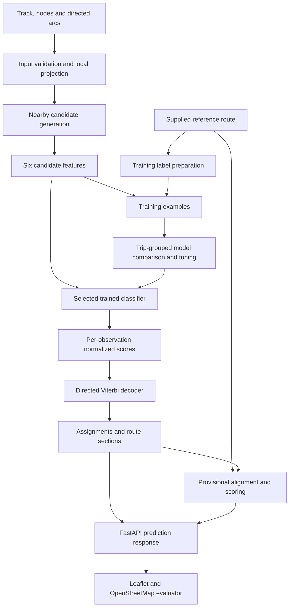

# PathSnap architecture and technical summary

Prepared on 18 November 2026 for the `backup-implementation` branch.

## Purpose and implementation scope

PathSnap reconstructs a vehicle's directed road route from noisy, timestamped GPS observations. The system first finds nearby road candidates, scores them with a trained classifier, and uses a directed Viterbi decoder to select a coherent sequence. A FastAPI service runs inference and reference scoring. A browser evaluator displays GPS observations, predictions, endpoints, optional reference geometry, warnings and aggregate results.

The repository also contains the data audit, provisional labeling, five-model comparison, Bayesian hyperparameter search, feature caches, evaluation scripts and Folium map generation. This document describes the independent backup implementation. The team branch has a separate Review 1 integration.

## Architecture



Inference loads the track and graph before producing candidate scores. References are loaded by the evaluation function after route prediction. Model inputs contain geometric and motion features. Labels and reference membership are excluded from inference features.

## Source-code map

| File or directory | Responsibility and reason |
| --- | --- |
| `inspect_trip.py` | Parse and validate files, project coordinates, generate candidates and produce audit maps. Establishes consistent geometry for training and inference. |
| `review_one.py` | Inventory dataset files, align ordered references, export baseline scores and integration fixtures. Enables early integration before model training. |
| `model_features.py` | Shared feature extraction, label eligibility and score normalization. Keeps offline and API preprocessing consistent. |
| `prepare_training.py` | Cache features, candidate arc IDs, observation indices, labels and feature schema per trip. Avoids repeating geometry work for each experiment. |
| `train_models.py` | Compare five classifiers, evaluate grouped folds, search hyperparameters and refit the selected model. |
| `route_decoder.py` | Directed shortest paths, Viterbi scoring, gap handling and route geometry reconstruction. |
| `learned_inference.py` | Load compatible model artifacts, run the full pipeline, then score assignments against references. |
| `evaluate_routes.py` | Compare classifier-only and decoded outputs, report per-trip and aggregate metrics, and export a Folium map. |
| `tune_decoder.py` | Evaluate explicit decoder configurations using development trips. |
| `build_model_catalog.py` | Refit and save the five classifiers, evaluate both supplied evaluation splits and build the UI model catalog. |
| `review_api.py` | Health, trips, models and prediction endpoints, configured data access and request logging. |
| `evaluator_ui/index.html` | Model/trip selection, map layers, metrics, reference comparison and loading/error states. |
| `evaluator_ui/vendor/` | Local Leaflet distribution and license. Removes CDN dependence for map code and styles. |
| `artifacts/model.joblib` | Default classifier artifact for requests without a model selection. |
| `artifacts/models/` | Five selectable model artifacts and their evaluation catalog. |
| `documentation/results/` | Committed experiment summaries and per-trip measurements. |
| `output/` | Regenerable local caches, manifests, maps and run outputs. |

## Dataset and file semantics

Each trip directory contains files named with its eight-digit ID.

| Extension | Contents |
| --- | --- |
| `.track` | Longitude, latitude and timestamp in seconds for each GPS observation. |
| `.nodes` | Longitude and latitude for road-network nodes. |
| `.arcs` | Source and destination node indices for each directed road arc. The zero-based row index is the arc ID. |
| `.route` | Ordered reference arc IDs traversed by the trip. |

The supplied development data contains 80 training trips and 10 student-test trips. The subsequently supplied organizer `evaluator_test` directory contains another 10 complete trips with references.

Input checks reject invalid column counts, nonfinite values, invalid longitude/latitude ranges, nonexistent graph endpoints, invalid reference IDs and decreasing timestamps. Dataset auditing additionally records disconnected graph components, route discontinuities, repeated timestamps and large gaps. Early inspection found a 153,064-second training GPS gap and 13 reference discontinuities, motivating explicit gap and failure handling.

## Coordinate projection and candidate generation

GeoJSON uses longitude, latitude. Leaflet rendering reverses each pair to latitude, longitude.

Geometry calculations use a local equirectangular projection centered on the trip. Longitude is scaled by the cosine of mean latitude, and angular distances are converted to metres. This is a practical local approximation for these road networks.

Final classifier candidate generation uses a **75 m radius** and a maximum of **16 directed candidates** per observation. A KD-tree over segment midpoints finds possible segments. Its search radius includes half the maximum segment length so a long nearby segment is not missed merely because its midpoint is distant. Exact projected point-to-segment distance then filters and orders candidates. Ties are resolved by arc ID.

The projected position on each candidate is stored as a fraction from 0 at the source node to 1 at the destination. Opposite directions remain distinct states, even when they share geometry.

## Provisional labels and eligibility

The reference gives an ordered route, while training requires a correct arc for each GPS observation. `align_reference` uses dynamic programming to minimize total squared GPS-to-reference-segment distance while permitting only nondecreasing reference positions.

An observation is eligible for supervised scoring when its distance to the aligned reference is at most **50 m**. Labels beyond that threshold are assigned -1 and excluded from supervised denominators.

This retained **185,159 of 208,417 training observations** and **19,133 of 19,160 student-test observations**. Training trip `00000054` accounts for 17,274 of 23,258 training exclusions. That concentration makes the resulting measurements sensitive to the alignment policy.

Candidate miss rate among eligible observations was approximately **0.46% in training** and **0.03% on student-test**. Missed correct candidates still count as errors in observation Top-1 accuracy.

These labels remain estimates. Junctions, parallel roads, repeated traversals and opposite directions can create ambiguous assignments. All reported pointwise accuracies in this document measure agreement with this alignment policy.

## Features and their rationale

| Feature | Definition | Reason |
| --- | --- | --- |
| `distance_m` | GPS distance to projected candidate segment. | Nearby roads are more plausible under ordinary GPS noise. |
| `arc_fraction` | Projected position between source and destination. | Captures endpoint and junction effects. |
| `rank` | One-based distance rank within the observation's candidates. | Supplies relative proximity in dense road networks. |
| `heading_agreement` | Cosine agreement between arc direction and observed GPS movement. | Distinguishes directed roads and helps resolve parallel candidates. |
| `heading_available` | Indicator that the local heading estimate is usable. | Lets the model distinguish absent heading from genuine perpendicular motion. |
| `speed_mps` | GPS movement divided by elapsed seconds when usable. | Describes the motion regime affecting heading reliability. |

Heading and speed are suppressed when the time step is nonpositive, exceeds 10 seconds, or movement is below 2 m. Zero-length arcs also have no usable heading. These rules reduce noise amplification at stops and after large gaps.

The same functions construct features during training, offline evaluation and API inference. Each saved artifact stores the feature names, candidate radius and candidate cap. Inference checks the feature schema before accepting the artifact.

## Training and classifier selection

The supervised task is binary candidate classification. A candidate is positive when its directed arc equals the observation's provisional aligned arc. Training uses seed **42**.

The first comparison fits up to **300 eligible observations per training trip**. Three-fold validation groups by trip, holding out whole trips. Validation and student-test scoring include all eligible observations. This avoids placing observations from one trajectory in both the training and validation subsets of a fold.

| Model | Implemented settings | Why included |
| --- | --- | --- |
| Logistic regression | StandardScaler, L2 penalty, C=1, maximum 200 iterations. | Interpretable linear baseline with feature standardization. |
| Gaussian naive Bayes | Variance smoothing 1e-9. | Fast probabilistic baseline for comparison with stronger nonlinear models. |
| Decision tree | Gini impurity, maximum depth 8, minimum 20 samples per leaf. | Models threshold interactions in distance, heading and speed. |
| Random forest | 32 trees, maximum depth 10, minimum 20 samples per leaf, two workers. | Reduces dependence on one tree and supplies a nonlinear ensemble baseline. |
| Histogram gradient boosting | Log loss, 75 iterations, maximum 15 leaves, learning rate 0.10. | Learns nonlinear feature interactions with compact saved artifacts and strong validation scores. |

The initial comparison produced the following candidate-level and observation-level measurements.

| Model | Grouped CV candidate Macro F1 | Student candidate Macro F1 | Student observation Top-1 |
| --- | ---: | ---: | ---: |
| Logistic regression | 0.8532 | 0.8664 | 80.74% |
| Gaussian naive Bayes | 0.8231 | 0.8347 | 81.22% |
| Decision tree | 0.8749 | 0.8888 | 81.26% |
| Random forest | 0.8724 | 0.8898 | 81.31% |
| Histogram gradient boosting | 0.8754 | 0.8910 | 81.49% |

Histogram gradient boosting won the original grouped candidate Macro F1 comparison. Its student-test log loss of 0.0873 was also the lowest among the initial models. The decision tree was close on validation and faster to score, so the margin supports a measured preference rather than a claim of decisive superiority.

### Bayesian optimization and final refit

The selected boosting model underwent six trials using a Matérn Gaussian-process surrogate and expected improvement. The objective was mean grouped training-fold candidate Macro F1. Maximum leaf counts were drawn from [7, 15, 31, 63], and learning rates from [0.025, 0.05, 0.10, 0.20].

The starting configuration remained best within that budget. Untuned and selected configurations were refit on all eligible training observations. They yielded identical student-test candidate Macro F1 of **0.8914**, observation Top-1 of **81.29%**, and log loss of **0.0863**. The search produced no improvement within six trials.

The current selectable catalog refits all five models on the full eligible training set using their recorded configurations. This differs from the sampled fits in the initial comparison table.

### Learned model weights

The fitted parameters live in the committed `.joblib` artifacts. Logistic regression stores standardized linear coefficients and an intercept. Naive Bayes stores class priors and per-feature distribution parameters. The tree models store split features, thresholds and leaf predictions. Gradient boosting stores its fitted tree ensemble.

The five classifier configurations use their standard equal sample weighting. There is no explicit class-weight override, per-trip loss multiplier or reference-distance weight. Selecting observations per trip limits large-trip dominance in the initial comparison. Full refitting subsequently includes all eligible candidate rows, so longer trips and observations with more candidates contribute more rows. Candidate imbalance is assessed using Macro F1 and confusion matrices. Logistic regression minimizes regularized log loss, the tree and forest use Gini split criteria, and histogram boosting minimizes log loss.

There is no manually assigned universal set of six classifier feature weights. The classifier learns their interactions from candidate labels. Numeric decoder penalties below are explicit sequence-scoring parameters and serve a different role.

## Probability normalization

The classifier estimates the positive-class probability for each candidate. Within each observation, scores are clipped to [1e-12, 1] and normalized to sum to one. The decoder uses their natural logarithms as emission scores. This provides comparable candidate preferences within an observation and avoids taking the logarithm of zero.

## Directed Viterbi decoder

A hidden state is a candidate directed arc and its projected fraction at a particular observation. The decoder stores the best accumulated score per state, records predecessor states and backtracks to produce one assignment per GPS observation.

Same-arc forward transitions use fractional arc distance directly. Other transitions travel to the previous arc's destination, follow a legal directed shortest path and reach the next candidate's projected position. Dijkstra searches are capped at 1,500 m and cached for up to 256 source nodes during a decode.

Let d be directed network travel distance in metres, g be GPS displacement in metres, e be normalized candidate probability, and U indicate an immediate switch between opposite directed versions of the same edge. The current score increment is

```text
log(max(e, 1e-12))
- abs(d - g) / 15
- 2 * max(0, d - g - 10) / 15
- 6 * U
```

The first distance term encourages agreement with GPS movement. The extra detour term penalizes excess road travel after a 10 m allowance. The U-turn penalty discourages a brief side-road excursion that immediately selects the reverse edge.

| Parameter | Current value | Effect |
| --- | ---: | --- |
| Maximum timestamp gap | 30 s | Starts a separate route section after a large or nonpositive time step. |
| Backward projection tolerance | 30 m | Absorbs small backward GPS fluctuations on the same directed arc. |
| Transition discrepancy scale | 15 m | Controls strength of network-distance versus GPS-displacement agreement. |
| Maximum speed | 55 m/s | Restricts feasible travel between observations. |
| Distance slack | 25 m | Allows positioning noise beyond the speed-based distance bound. |
| Hard transition distance cap | 1,500 m | Bounds network search and transition travel. |
| Detour penalty multiplier | 2 | Adds cost to excess travel above GPS displacement plus 10 m. |
| Immediate reverse-edge penalty | 6 | Discourages abrupt switches between opposite directed arcs. |

A transition must satisfy d <= min(1500, 55 * elapsed_seconds + 25). The backward tolerance permits limited projected reverse movement on the same arc and uses its absolute distance for scoring. It is a noise model and can still produce small reversals in displayed geometry.

Missing candidates create unmatched assignments and split sections. When every transition is infeasible, the decoder restarts and records an impossible-transition warning. Distinct sections are returned as a MultiLineString so rendering preserves the gaps.

Route geometry includes projected endpoints and intermediate road nodes from selected directed shortest paths. The renderer displays the actual decoded sections. It does not trim branches using the reference route.

## How accuracy improved

The largest gains came from correcting sequence behavior while retaining the fitted histogram-gradient classifier.

| Decoder stage | Student-test accuracy | Organizer accuracy | Explanation |
| --- | ---: | ---: | --- |
| Original decoder | 79.38% | 68.49% | Small backward projection changes could require an artificial full network loop. |
| Jitter correction and development-selected transition settings | 92.21% | 93.39% | 30 m same-arc tolerance, 15 m scale and 25 m slack greatly reduced false section breaks. |
| Additional excess-distance penalty | 93.01% | 94.18% | Discouraged travel exceeding observed movement. |
| Immediate reverse-edge penalty | **93.45%** | **95.30%** | Reduced short outward-and-return excursions. |

On the original organizer baseline, the decoder produced 414 sections and 399 impossible transitions. The jitter correction reduced these to 16 sections and one impossible transition. On organizer trip `00000015`, adding the U-turn penalty reduced immediate selected reverse-edge switches from **177 to 4**. Its pointwise accuracy rose from **90.58% to 92.77%**.

These gains demonstrate that classifier quality and route quality are distinct. A relatively modest candidate scorer can produce substantially better observation assignments when temporal and road-network constraints resolve local ambiguity.

## Current model catalog

Every row below uses a full-training classifier followed by the current decoder.

| Classifier | Student-test accuracy | Organizer accuracy | Combined accuracy |
| --- | ---: | ---: | ---: |
| Histogram gradient boosting | **93.45%** | 95.30% | **94.39%** |
| Logistic regression | 92.69% | 93.76% | 93.23% |
| Decision tree | 92.60% | **95.39%** | 94.02% |
| Random forest | 92.60% | 95.12% | 93.88% |
| Gaussian naive Bayes | 91.85% | 93.62% | 92.75% |

The UI orders the dropdown by student-test decoded accuracy, placing histogram gradient boosting first. Decision tree has a slightly higher organizer score in this recorded run. The catalog retains the development-based order.

The combined figure weights eligible observations equally across the two evaluation sets. It sums correct predictions and divides by 19,133 + 19,653 = **38,786 eligible observations**. It is not an unweighted average of trip percentages. The UI also shows the two split-specific scores.

The exact per-trip counts and aggregate values are committed in [the model catalog](../artifacts/models/catalog.json).

## Metric definitions and interpretation

| Metric | Meaning |
| --- | --- |
| Candidate Macro F1 | Binary candidate-label F1 averaged across positive and negative classes using probability threshold 0.5. |
| Candidate log loss | Quality of positive-class probability estimates before per-observation normalization. |
| Observation Top-1 | Fraction of eligible observations whose highest-scoring candidate equals the provisional label. |
| Decoded pointwise accuracy | Fraction of eligible observations whose final Viterbi assignment equals the provisional label. |
| Sequence similarity | SequenceMatcher ratio after collapsing consecutive repeated arc IDs on eligible observations, averaged across trips. |
| Matched observations | Observations assigned an arc. Matching every observation does not imply every assigned arc is correct. |
| Route sections | Separate generated polylines after gap and transition handling. |
| Impossible transitions | Restarts caused by a lack of feasible candidate transitions. |

The 95.30% organizer figure is pointwise agreement against provisional aligned references. It is not geometric overlap, exact whole-route recovery or an independently issued organizer score.

## Evaluation boundaries and remaining limitations

Only the supplied training partition is used to fit classifier parameters. Original classifier selection uses grouped training folds. Decoder settings were explored on student-test data. The organizer set was initially used as a holdout, and its results and failure cases were subsequently inspected during iterative development. Later organizer measurements should therefore be described as observed evaluation-set performance. A fresh unseen set is needed for an independent final generalization estimate.

The original data audit, label policy and eligibility exclusions remain relevant to all figures. Whole-trip grouping limits trajectory leakage in the original comparison. Model artifacts and catalog results describe different fit stages, so initial sampled-model scores should not be substituted for the current full-refit scores.

Trip `00000030` remains a documented weakness. Histogram gradient boosting achieves **88.99%**, while logistic regression achieves **89.45%**. With the boosting model, 41 of 72 errors occur in the first 41 observations, 23 errors choose a reversed road direction, and all correct reference arcs are present in the candidate lists. This points to motion/direction ambiguity and sequence choices rather than missing candidates. A temporal-heading experiment failed to improve overall student-test pointwise accuracy and was discarded.

Other remaining limitations include local projection approximation, provisional reference alignment, finite candidate radius/cap, a 1,500 m network search limit, heuristic transition parameters and legitimate U-turns that may be discouraged by the reverse-edge penalty. The model catalog scores are offline measurements and must be regenerated if model artifacts, feature extraction, label rules or decoder defaults change.

## API and configuration

| Endpoint | Behavior |
| --- | --- |
| GET /health | Reports readiness and active mode. |
| GET /trips | Lists string trip IDs from the active dataset or manifest. |
| GET /models | Returns selectable model IDs, labels and recorded aggregate scores. |
| POST /predict | Accepts trip_id and optional model_id, runs inference and returns GPS, route geometry, metrics and warnings. |

Prediction coordinates use GeoJSON MultiPoint and MultiLineString objects. Unknown trip/model IDs return 404. Unavailable inference returns 503. Request logs contain request ID, client address, path, method, selected trip, status and duration.

| Environment variable | Purpose |
| --- | --- |
| PATHSNAP_MODE | review for fixtures, student for supplied student-test trips, evaluator for a manifest. |
| PATHSNAP_DATA | Root of training/student-test dataset. |
| PATHSNAP_MODEL | Default saved classifier path. |
| PATHSNAP_EVALUATOR_MANIFEST | Server-side JSON mapping displayed IDs to ten distinct evaluator directories. |
| PATHSNAP_REVIEW_OUTPUT | Generated Review 1 fixture directory. |
| PATHSNAP_UI_ORIGINS | Comma-separated allowed browser origins. |
| PATHSNAP_SHOW_REFERENCE | Set to 1 to include supplied reference geometry for explicit comparison. |

The optional reference layer is generated after decoding. Leave reference display disabled when evaluation rules require reference geometry to remain server-side.

## Frontend and visualization

The evaluator uses locally bundled Leaflet code and CSS with OpenStreetMap tiles. Local bundling fixed a failed stylesheet-integrity dependency that previously caused tiles to appear as scattered page images. Basemap tile downloads still require network access.

The UI provides model selection, organizer trip selection, automatic first-trip inference, GPS and predicted-route toggles, an optional orange reference layer, green start and red destination markers at the first and last GPS observations, fit-to-route control, trip metrics and aggregate evaluation scores. Start/destination indicate observed endpoints, since an intended destination is not separately supplied.

Requests use AbortController to cancel superseded work, and returned trip IDs are checked before display. The interface shows loading and error states and allows prediction retries. CORS permits the configured UI origin to call the API.

Folium exports support the hackathon's required geographical visualizations. They include GPS, candidate roads, supplied development references and decoded routes where available.

## Reproduction and two-laptop execution

Run from the repository root with Python 3.11 and the supplied datasets installed locally.

```powershell
python -m venv .venv
.\.venv\Scripts\python.exe -m pip install -r requirements.txt
$env:OMP_NUM_THREADS = '2'
$env:OPENBLAS_NUM_THREADS = '2'
.\.venv\Scripts\python.exe prepare_training.py
.\.venv\Scripts\python.exe train_models.py --sample 300 --trials 6
.\.venv\Scripts\python.exe build_model_catalog.py
.\.venv\Scripts\python.exe evaluate_routes.py --student-test evaluator_test --output output/evaluator-current
```

The source expects train and student_test under `Student folder/Student folder`, and evaluator_test at the root for catalog rebuilding. Dataset files are local inputs. Training and catalog rebuilding should use consistent dependency versions.

Example manifest stored at `output/evaluator-manifest.json`, with the remaining nine trip entries following the same structure

```json
{
  "00000015": "../evaluator_test/00000015",
  "00000017": "../evaluator_test/00000017"
}
```

The actual manifest must contain ten distinct trip directories. Relative paths resolve against the manifest directory.

On Laptop 1, start the evaluator API

```powershell
$env:PATHSNAP_MODE = 'evaluator'
$env:PATHSNAP_EVALUATOR_MANIFEST = (Resolve-Path 'output/evaluator-manifest.json').Path
$env:PATHSNAP_SHOW_REFERENCE = '1'
.\.venv\Scripts\python.exe -m uvicorn review_api:app --host 0.0.0.0 --port 8001
```

On Laptop 2, serve the browser UI from its repository checkout

```powershell
python -m http.server 8080 --bind 127.0.0.1 --directory evaluator_ui
```

Open http://127.0.0.1:8080 on Laptop 2 and set API address to http://LAPTOP_1_LAN_IP:8001. Both machines need network reachability to Laptop 1's port 8001. Match a successful prediction in the UI to the receiving laptop's request log. For same-laptop testing, use http://127.0.0.1:8001.

The UI's default API field is port 8000. Enter port 8001 explicitly when using the commands above, or supply the api URL query parameter.

## Verification and evidence

Eight backup tests passed after model selection was added. Decoder regression coverage includes tolerating small same-arc jitter, splitting motion beyond tolerance and preferring a plausible forward candidate over an ambiguous immediate reverse edge. Live API checks exercised all five model IDs on organizer trip 00000030. Frontend inline JavaScript passed syntax validation. Visual browser automation was unavailable in this session, so rendered appearance was inspected through user-provided screenshots and iterative feedback.

Recorded evidence includes

- [Original classifier comparison](results/model_comparison.csv)
- [Original training experiment log](results/experiments.json)
- [Jitter-corrected student results](results/student-improved-summary.json)
- [Jitter-corrected organizer results](results/evaluator-improved-summary.json)
- [Detour penalty experiments](results/detour-experiment.json)
- [Detour penalty organizer evaluation](results/detour-evaluator.json)
- [U-turn penalty student experiments](results/uturn-student.json)
- [U-turn penalty organizer evaluation](results/uturn-evaluator.json)
- [Current five-model catalog and per-trip counts](../artifacts/models/catalog.json)

The final report should pair these measured results with actual map and UI screenshots and receiving-laptop logs. Dataset provenance, provisional labels, iterative evaluation and assistance disclosures should be stated according to the organizer's submission requirements.
